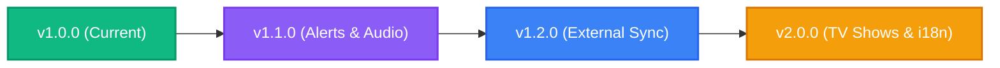

# 🗺️ Stremio Watchlist (Good Quality Tracker) — Roadmap

Welcome to the development roadmap for **Stremio Watchlist (Good Quality Tracker)**. This document outlines completed milestones, upcoming feature priorities, and the long-term vision for the project.

---

## 🎯 Project Vision

Provide a seamless, cloud-native watchlist manager and stream quality tracker for Stremio that works 24/7 across Smart TVs, desktop, and mobile devices—notifying users the moment high-definition and 4K digital releases drop, with zero CAM/theater false positives.

---

## 🌟 Milestone Overview

| Version    | Status                   | Focus Area                           | Key Highlights                                                                            |
| ---------- | ------------------------ | ------------------------------------ | ----------------------------------------------------------------------------------------- |
| **v1.0.0** | 🟢 **Released (Stable)** | Core Quality Tracker & Stremio Addon | Anti-CAM detection, 1-click install, curated streaming lists, backup, 24h feedback banner |
| **v1.1.0** | 🟡 **In Planning**       | Proactive Alerts & Audio Preferences | Telegram/Discord bot notifications, Dual Audio / PT-BR tags, Dolby Vision / HDR10+        |
| **v1.2.0** | ⚪ **Planned**           | External Watchlist Integrations      | Letterboxd URL/CSV import, Trakt.tv two-way sync, IMDb import                             |
| **v2.0.0** | ⚪ **Future Major**      | TV Shows & Ecosystem Expansion       | Episode/Season tracking in 1080p/4K, multi-language UI (i18n), public developer API       |

---

## 🟢 v1.0.0 — Stable Production Release (Delivered)

> [!NOTE]
> All core features below are fully tested with **22 test suites (208 passing automated tests)** and running in production.

- [x] **Smart Quality Detection Engine**:
  - Distinguishes authentic digital releases (WEB-DL, BluRay, 1080p, 4K UHD) from theater rips (CAM, Telesync, HDCAM, LINE, MIC DUB, Telecine).
  - Stream count and clean stream count tracking with strict year and title boundary verification.
- [x] **Stremio Account Integration**:
  - Secure authentication via official Stremio API.
  - **1-Click Installation:** Installs addon directly into the user's Stremio account without manual manifest copying.
  - Native dynamic catalogs for Stremio:
    - `Watchlist: Ready (Good Quality)`
    - `Watchlist: All Movies`
    - `Watchlist: Waiting for Quality`
    - Independent catalogs for each custom list.
- [x] **Curated Streaming Catalogs**:
  - 1-click import of new and upcoming releases from **Netflix**, **Disney+**, **HBO Max**, **Prime Video**, and **Apple TV+**.
- [x] **Letterboxd 2026 Popular Recommendations**:
  - Rotating cinematic banner featuring the top 6 trending movies on Letterboxd for 2026.
  - 1-click watchlist addition and live quality indicators.
- [x] **Custom Lists & Automatic Cleanup**:
  - Create, rename (with custom emojis), and delete personalized lists.
  - Automatic removal of orphaned movies when a list is deleted.
- [x] **Backup & Recovery**:
  - Authenticated export/import of watchlist JSON with timestamped backups.
- [x] **Feedback & Sponsor Banner**:
  - 24-hour smart dismissal TTL with direct GitHub Sponsor and Tally form integration.

---

## 🟡 v1.1.0 — Smart Alerts & Audio/Video Preferences (Target: Q1 2026)

The primary focus of **v1.1.0** is turning the tracker into a proactive personal assistant that notifies users wherever they are.

### 1. 🔔 Proactive Notifications (Telegram & Discord)

- [ ] **Telegram Bot Integration (`@StremioWatchlistBot`)**:
  - Link Telegram account via 6-digit code or deep-link.
  - Immediate push notification when a tracked movie drops in 1080p or 4K:
    > _"🎉 Great news! **'Oppenheimer'** is now available in **4K UHD • WEB-DL** (18 clean streams). Open in Stremio: [Link]"_
- [ ] **Discord Webhooks**:
  - Custom Discord webhook URL in Settings to post release updates into personal or community channels.
- [ ] **Web Push Notifications**:
  - Browser push notifications for desktop and mobile Chrome/Safari.

### 2. 🇧🇷 Audio & Language Preference Filters

- [ ] **Dual Audio & Dubbed Detection (PT-BR, ES, etc.)**:
  - Detect tags such as `DUAL`, `DUBLADO`, `NACIONAL`, `PT-BR`, `LEG` in stream descriptions.
  - New filter option: _"Show only releases with Portuguese audio/subtitles"_.
- [ ] **Embedded Multi-Subtitles Tagging**:
  - Identify streams containing official SRT/VobSub subtitle packs.

### 3. 💎 Advanced Video & Audio Badges

- [ ] **HDR & Video Standards**:
  - Detection for `Dolby Vision (DV)`, `HDR10+`, `IMAX Enhanced`, and `REMUX`.
- [ ] **Surround & Lossless Audio**:
  - Recognition of `Dolby Atmos`, `TrueHD 7.1`, `DTS-HD MA`, and `FLAC 5.1`.

---

## ⚪ v1.2.0 — External Watchlist Sync & Import (Target: Q2 2026)

Connect your existing movie tracking profiles from across the web into Stremio Watchlist with zero friction.

### 1. 🍿 Letterboxd Integration

- [ ] **URL Import**:
  - Paste any Letterboxd watchlist or list link (e.g. `letterboxd.com/user/watchlist/`).
  - Automatic title extraction and IMDb ID mapping via Cinemeta.
- [ ] **Letterboxd CSV Import**:
  - Upload Letterboxd export ZIP/CSV files directly into your account.

### 2. 🔄 Trakt.tv Integration

- [ ] OAuth2 Sign-In with Trakt.tv.
- [ ] Two-way synchronization: Trakt Watchlist ⇄ Stremio Watchlist.
- [ ] Automated scrobble alignment (mark watched in both platforms).

### 3. 📋 IMDb & CSV Data Portability

- [ ] Direct import of IMDb exported watchlists (`ratings.csv` / `watchlist.csv`).
- [ ] Bulk import plain text or list of IMDb IDs.

---

## 🚀 v2.0.0 — TV Shows & Multi-Language Platform (Target: H2 2026)

The next major chapter: extending the tracker from movies to full television series and expanding to global audiences.

### 1. 📺 Full TV Series & Episode Tracking

- [ ] **Per-Episode & Season Tracking**:
  - Monitor TV series episodes (`tt...:s:e`) for 1080p/4K releases.
  - Track complete season packs (e.g. `Season 1 Complete 1080p WEB-DL`).
  - Stremio catalog for _"Next Episode Ready to Watch"_.

### 2. 🌍 Internationalization (i18n)

- [ ] Multi-language user interface:
  - English (default)
  - Portuguese (Português do Brasil)
  - Spanish (Español)
- [ ] Localized catalog titles and status badges.

### 3. 🔌 Public Developer REST API & Webhooks

- [ ] Read-only and read-write developer API tokens.
- [ ] OpenAPI / Swagger documentation.
- [ ] Integration documentation for Home Assistant, Radarr, and Jellyfin.

---

## 💡 Submitting Feedback & Proposing Features

Have an idea that isn't on the roadmap? We'd love to hear from you:

- **Feedback Form:** [Share your feedback on Tally](https://tally.so/r/dbazxA)
- **GitHub Issues:** [Open a Feature Request on GitHub](https://github.com/streamreadyapp/stream-ready/issues)
- **Support the Project:** [Become a Sponsor on GitHub](https://github.com/sponsors/debora-rebelatto)
